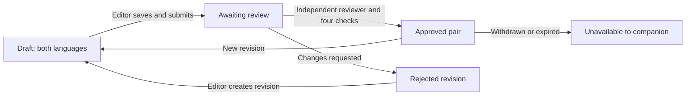

# Knowledge review workflow — local vertical slice

Implemented on `development/next-generation`, 25 November 2026. Owner instructions:
[KNOWLEDGE-DESK.txt](../next-generation/KNOWLEDGE-DESK.txt). Local staff URL:
http://127.0.0.1:43129/staff/. The existing hosted app is unchanged.

## Actual implementation

Named editor and reviewer accounts, independent approval, paired Hebrew/English
revision editing, submission, rejection, revision creation, expiry, withdrawal and
append-only audit. Reviewers explicitly attest to current source, Hebrew, English
and scope checks, provide a professional review note and an expiry. Authentication
uses salted scrypt password hashes, HttpOnly/SameSite session cookies, exact origins,
CSRF checks, bounded requests/login attempts and session expiry. Account roles are
rechecked at each action, including inside the publication transaction.

The four starter topics are **source-checked drafts awaiting professional sign-off**.
No real staff accounts or fake professional approvals were created. The owner
enrols actual people through Setup-Knowledge-Staff.cmd. Code can enforce separate
identities and attestations; it cannot establish that a person is qualified or
independent in practice. Organizational SSO/MFA and professional governance remain
requirements for a hosted staff pilot.

## Source verification record

Official pages were opened and their relevant content checked on 25 November 2026.
The source language is Hebrew; English is a proposed companion translation.
Evidence summaries in the seed identify the claim that a reviewer should recheck.
No eligibility decision, changing monetary rate or processing-time promise is seeded.

| Topic | Official source | Checked scope | Human status |
| --- | --- | --- | --- |
| Career guidance | [Official counselling page](https://www.hachvana.mod.gov.il/ConsultationAndDirection/Consultation/Pages/default.aspx) | Guidance routes and booking; individual eligibility must be checked | Pending professional review of both languages |
| Academic deposit checks | [Official study instructions](https://www.hachvana.mod.gov.il/GrantAndDeposit/DepositUpTo5/Pages/education.aspx) | Recognition, balance and voucher checks | Pending professional review of both languages |
| Vocational deposit checks | [Official training instructions](https://www.hachvana.mod.gov.il/GrantAndDeposit/DepositUpTo5/Pages/ProfessionalTraining.aspx) | Verify the specific training route before commitment | Pending professional review of both languages |
| Permitted deposit use | [Official deposit overview](https://www.hachvana.mod.gov.il/GrantAndDeposit/DepositUpTo5/Pages/default.aspx) | Verify purpose, conditions and personal balance through official channels | Pending professional review of both languages |

The import is idempotent: restarting or changing the seed does not overwrite an
existing topic, approve it or replace a staff revision. New seed topics remain
drafts. Existing content changes require an editor's new revision and an independent
reviewer. Sources checked more than 30 days ago must be checked and dated again
before approval. Publication expiry is at most 90 days after approval.

## Publication and privacy boundary

Approval atomically publishes both languages and provenance. If any publication
write fails, the status, audit and both language rows roll back. An approved record
must match its immutable revision; direct table changes cannot pass the published
view. New drafts/rejections preserve the previous approved publication. Replacement
approval supersedes it atomically. Withdrawal is immediate; expiry is checked on
every read, with no stale cached copies.

The companion requests only public domain/language knowledge from the loopback desk.
No soldier identity, message, goal or conversation goes to this database. Its public
read endpoint excludes staff identities, passwords, notes and audit. Staff access
does persist names, role descriptions, salted hashes and action records, separate
from encrypted soldier memory.

## Local persistence decision

The desk runs real embedded PostgreSQL through PGlite. A Windows restart test exposed
a native filesystem lock-file permission failure. The desk now uses PGlite's memory
filesystem with Node-managed, compressed snapshots, written to a temporary file,
flushed and atomically renamed before acknowledging a mutation. A per-process queue
serializes durable transactions. A failed write poisons the local store so reads
fail closed until restart; it never falls back to an old approval automatically.

The local snapshot includes staff password hashes and must remain private. The
desk is single-process, protected by an owner lock. This is a small local workbench,
not a scalable public database host. SQL and the EditorialStore transaction adapter
also support a dedicated PostgreSQL pool; remote connection/role deployment has
not been exercised. PGlite snapshot compatibility across engine upgrades must be
tested; it is not a standard PostgreSQL backup format.

## Verified and remaining

Tests cover the real SQL lifecycle, role/contributor rejection, incomplete review,
stale edits, immutable revisions/events, replacement, expiry/withdrawal, atomic
rollback, source/date/bilingual validation, HTTP authentication/CSRF/session limits,
companion retrieval and two independent Node process restarts with staff login.
Staff UI tests cover Hebrew/English, text rendering, role-specific controls and
review checkboxes. Browser checks cover the real pending-source preview in both
languages at mobile width. No real professional review, live LLM, physical-phone
audit, hosted SSO/MFA, remote PostgreSQL or production deployment is claimed.
