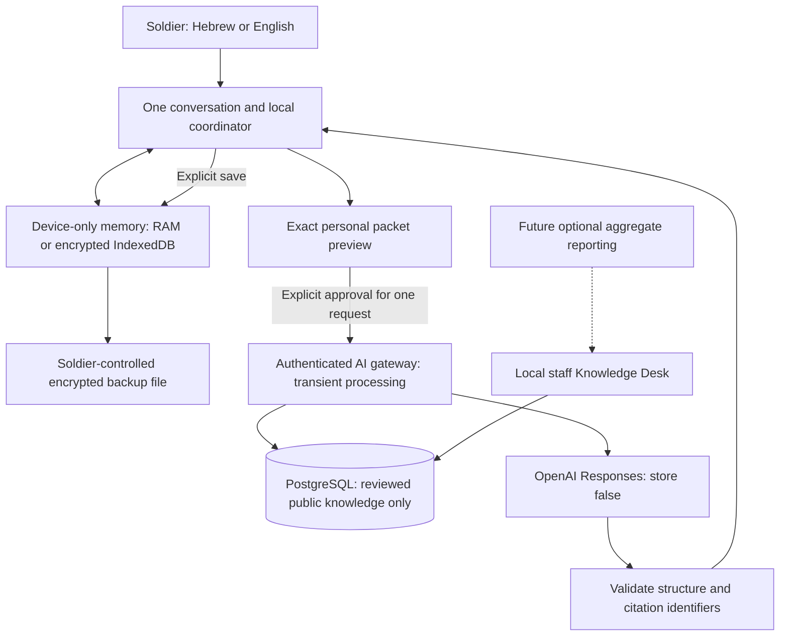

# Momentum Next Generation: master architecture

Status: Phase 1 foundation plus local knowledge review workflow, 25 November 2026. Branch:
`development/next-generation`. Operational base: `a45bf753045682e6afdd8c998ab5bf00eca6126b`
on `complete/continuity-and-followup`. This document distinguishes implemented
foundations from the long-term design. Nothing here authorizes a production release.

## One companion, two data boundaries

The soldier sees one continuous conversation. Specialist selection happens behind
that conversation. Goals and confirmed skills belong to one shared private memory,
not independent agent profiles. Changing language or subject preserves the thread.
The soldier can also use a temporary session without creating an account or vault.

No soldier conversation, profile, ID, goal, inferred condition or activity timeline
belongs in central PostgreSQL. Transient gateway processing is still a disclosure;
local storage does not make an external model local. There is no background model
request, cross-device sync, telemetry, automatic export or migration in Phase 1.

## Implemented foundation

| Component | Implementation | Practical limit |
| --- | --- | --- |
| Conversation | `next-generation/public/`: direct chat home, compact composer, Hebrew/English, RTL/LTR, separate help and sources | New shell, not full feature parity with legacy |
| Private memory | AES-256-GCM IndexedDB envelope; PBKDF2-SHA256 passphrase key, RAM-only unlock; encrypted backup/import/delete | Device/browser security and passphrase strength still matter |
| Follow-through | Shared local goals, optional dates, explicit save, done/reopen | No push reminders, calendar or automatic intervention |
| Coordinator | Bilingual domain routing with recent topic continuity in the one memory | Deterministic router, not autonomous multi-agent planning |
| Education/employment specialists | Domain-scoped instructions selected by the coordinator in one gateway call; local guided fallback | Live model quality has not been evaluated; local guidance is scripted |
| OpenAI gateway | Responses API, fixed server instructions, strict structured output, local validation, no tools, one-use request approval | Local development access token, not a public identity system |
| Knowledge | SQL migrations, immutable paired revisions, approved publication view, date/source filters | Four source-checked bilingual draft topics; no professional sign-off yet |
| Staff workflow | Separate local editor/reviewer accounts; bilingual editing, review, approval, rejection, replacement, withdrawal and audit | Local workbench; organizational SSO/MFA and actual professional sign-off remain |
| Automated checks | Existing regression suite, new crypto/HTTP/SQL/UI tests, Linux and Windows CI jobs | Mock provider and embedded PostgreSQL, not hosted integration |

## UI foundation and review

The attached review is treated as design input, not as evidence of current benefit
amounts. A 56px header, single transcript scroller, four initial topics and compact
bottom composer replace large welcome/intake surfaces in this new shell. Benefits
and human help appear in modal panels, never inside the transcript. There are no
upfront phone/email requests, empty chat-history control, CV-generation spinner,
fake Momentum coordinator or automatic communication-style prompt.

Heebo is self-hosted with its OFL license, so rendering does not disclose an IP
address to a font CDN. All conversation content is rendered as text. Voice requires
a separate disclosure before each action because browser speech can use external
providers. Text remains available when speech is unsupported or declined. The new
app does not register a service worker; offline use means a running local Node host.

## Long-term components, not yet implemented

**Knowledge operations and administration.** The local staff portal now implements
named editor/reviewer accounts and independent approval. Staff can
draft bilingual claims, attach original official sources, record the verification
date and expiry, approve or withdraw a version, and inspect staff action history.
Automated checks may flag stale links; they must not silently approve new claims.
The local PostgreSQL engine persists through atomic snapshots and enforces immutable
history. See KNOWLEDGE_REVIEW_GUIDE.md. Organizational SSO/MFA, remote role deployment,
independent qualifications verification and a hosted portal remain future work.
Use separate migration/editor/read-only runtime database roles when hosting.

**Verified retrieval.** Current retrieval is domain/language/date based, bounded
to eight records. Later add reviewed search indexes and semantic retrieval over
public knowledge. Do not embed personal messages or upload a personal vector store.
Return source title, URL, version, review and expiry with consequential claims.
Source evidence is untrusted input; citation presence alone does not prove that a
claim is supported. Human editorial review and claim-level evaluations remain gates.

**Additional specialists.** Benefits, financial planning, housing, health-navigation,
social connection, entrepreneurship and family/community use the same packet,
memory, safety and suggestion contracts. They do not acquire independent access
to private memory, tools, credentials or external services. Clinical, legal and
financial decisions require appropriate human support and verified current sources.

**Follow-through.** Add user-confirmed action sequencing, dependencies, check-in
preferences and optional reminders locally. Never convert a model suggestion into
a saved commitment, notification or outside message without the soldier's action.

**Aggregate insight.** Disabled in Phase 1. A future opt-in design would compute
coarse counters on device, use minimum cohort thresholds and a reviewed differential
privacy budget, exclude free text/IDs/stable device identifiers, and discard small
or linkable groups. Do not claim that IP logging or pseudonyms are anonymous. No
analytics collector, central event table or privacy-policy change is introduced.

## Deployment and version boundaries

The operational review remains at
[its existing URL](https://transition-companion-review.onrender.com/) and the
[existing Render service](https://dashboard.render.com/static/srv-dbsb37jl550s73fvm5t0).
Its branch, static publish list, proxy and auto-deploy configuration are unchanged.
The new app uses loopback port 43128 and separate IndexedDB; legacy uses 43127 and
its existing stores. No automatic personal-data migration is safe to assume.

A later hosted Next Generation pilot needs explicit authorization, isolated review
hosting, TLS, real user access control, abuse protection, retention configuration,
editorial staff, human referral review and privacy/security assessment. Keep this
separate from production. Ordinary code pushes currently run tests only. Root
AGENTS, APP-OPERATIONS and CLAUDE share the same deployment boundary.

## Decisions

- ADR-001: Branch from the current working review rather than older main; preserve
  the deployed app byte-for-byte and open a draft PR against that base.
- ADR-002: Isolate a small ES-module Node/browser application instead of rewriting
  the existing monolithic multilingual pages. Node 24 matches the existing runtime.
- ADR-003: Session-first, optionally passphrase-encrypted IndexedDB; no central
  soldier persistence, account requirement, plaintext browser store or automatic sync.
- ADR-004: Use one bounded model call with domain-specific instructions. Independent
  model agents and autonomous tools add privacy, latency and cost before value is tested.
- ADR-005: PostgreSQL stores reviewed public knowledge only; ship no unverified
  claims or benefit amounts copied from a review. Fail closed when no evidence exists.
- ADR-006: Approval binds the exact minimized personal packet to a single-use ticket.
  This is an engineering guard, not proof of legal consent or a new privacy policy.
- ADR-007: No new paid service, existing deployment change, production merge or
  personal-data migration. Future releases use explicit pilot gates.
- ADR-008: Add a separate local staff desk on 43129. Imported source checks are
  drafts; an independently enrolled reviewer must attest to both languages and
  source/scope before atomic publication. Revisions and audit are append-only.
- ADR-009: A native PGlite filesystem restart failed on this Windows computer.
  Use its memory filesystem with flushed, atomic snapshots and serialized durable
  transactions. Test independent Node processes; do not infer durability from a
  same-process reopen. Hosted PostgreSQL remains a separate deployment decision.
